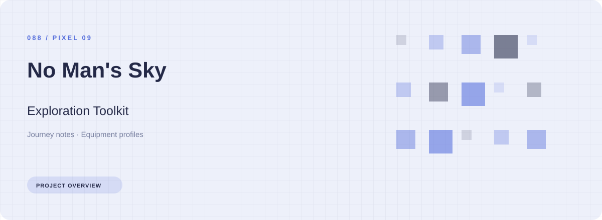
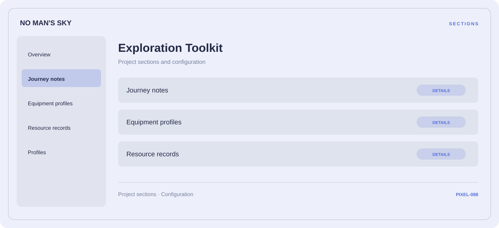

# 🛠️ No Man's Sky Exploration Toolkit

**Journey notes · Equipment profiles · Resource records**

## ⚡ Features

No Man's Sky Exploration Toolkit uses a concise workspace for journey notes, equipment profiles, and resource records. The feature map follows the same order as the project navigation.

### ⚙️ Journey notes

Route stages, transport context, and the notes associated with each part of the journey.

### 🧩 Equipment profiles

Related settings collected into named groups for a clearer configuration workflow.

### ⌨️ Resource records

Inventory and resource categories organized alongside their related values and notes.

## 🖥️ Project navigation

## 📥 Download

The button and cover open the project's download page. Use the information supplied with the downloaded package for installation and release-specific requirements.

## 📚 Project documentation

- [Feature reference](docs/FEATURES.md)
- [Download information](docs/DOWNLOAD.md)
- [Project page](index.html)

---

No Man's Sky Exploration Toolkit · Program documentation and download information.
